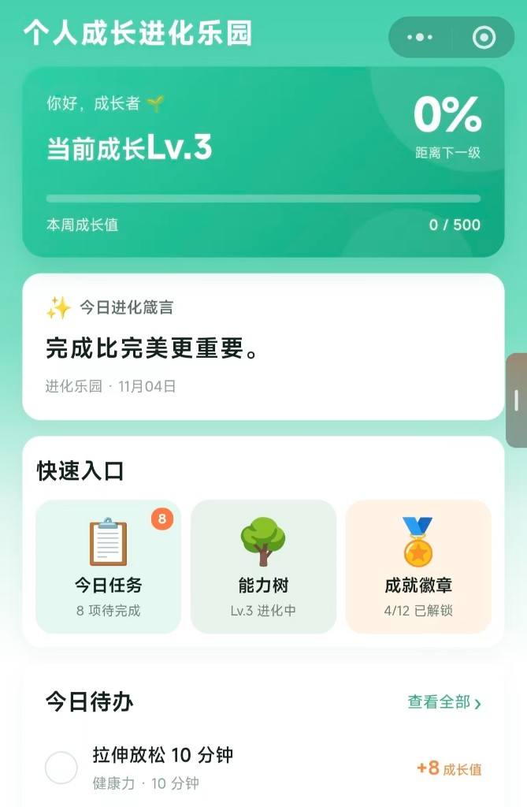
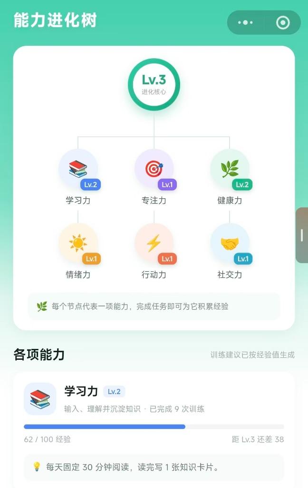
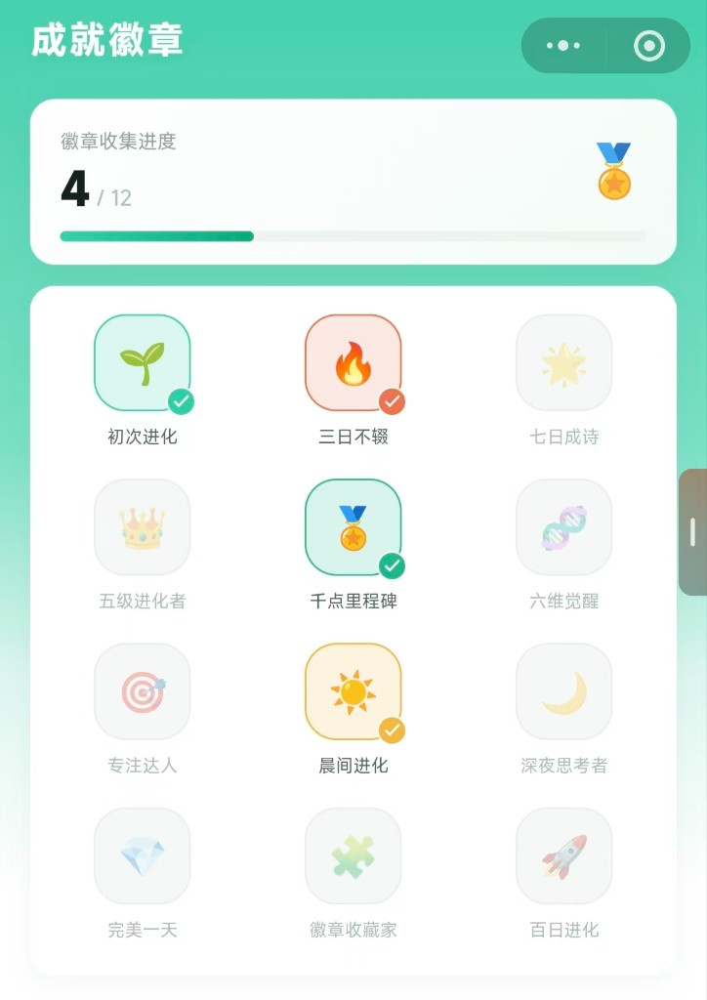

# Growth Eden · 个人成长进化乐园

**Personal Growth WeChat Mini Program (MVP)**

用「每日小任务 → 成长值 → 等级 / 六维能力 / 成就徽章」把坚持变成看得见的进度。

[](LICENSE)


---

## 简介 | Overview

**中文**  
个人成长进化乐园是一款面向个人的习惯与成长记录小程序。用户每天完成阅读、运动、专注等轻量任务，获得成长值，解锁等级、六维能力经验与成就徽章。数据默认保存在本机，可选接入微信云开发同步。

**English**  
*Growth Eden* is a WeChat mini program MVP for personal habit-building and self-improvement. Users complete daily micro-tasks, earn growth points, level up six skill dimensions, and unlock achievement badges. Local-first storage with optional cloud sync.

---

## 预览 | Preview

| 首页 | 能力进化树 | 成就徽章 |
|:---:|:---:|:---:|
|  |  |  |

> 真机效果：微信开发者工具 → 导入本项目 → **编译** → **预览** 扫码。

---

## 功能 | Features

| 模块 | 说明 |
|------|------|
| 🏠 **首页** | 成长总览、今日箴言、快捷入口、今日待办 |
| 📋 **成长任务** | 每日任务列表、能力筛选、完成任务反馈、换一批 |
| 🌳 **能力树** | 六维能力（学习 / 专注 / 健康 / 情绪 / 行动 / 社交）进化树与训练建议 |
| 🏅 **成就徽章** | 12 枚徽章、里程碑进度 |
| 👤 **我的** | 微信头像与昵称、成长统计、功能菜单、7 日曲线、进化宣言 |

### 核心规则（MVP）

- 每日 **8** 项任务（按日期种子生成，同一天固定）
- 本周成长值每满 **500** 升 1 级（周一重置本周进度）
- 每项能力经验 0–100，满级升级（上限 Lv.10）
- 连续打卡、完美一天等触发徽章条件

详细产品与视觉规范见：[个人成长进化乐园-产品与视觉说明.md](./个人成长进化乐园-产品与视觉说明.md)

---

## 快速开始 | Quick Start

### 环境要求

- [微信开发者工具](https://developers.weixin.qq.com/miniprogram/dev/devtools/download.html)（稳定版）
- 微信小程序 AppID（测试可使用测试号；云开发需正式 AppID）

### 导入与运行

1. 克隆本仓库  
   ```bash
   git clone https://github.com/hex26725007/growth.git
   ```
2. 打开微信开发者工具 → **导入项目**  
3. 目录选择仓库根目录 **`growth`**（包含 `growth-eden` 子文件夹的一层）  
4. 在 `growth-eden/project.config.json` 或根目录 `project.config.json` 中填入你的 **AppID**  
5. 点击 **编译** → **预览**（手机微信扫码）

### 云开发（可选）

1. 开发者工具 → **云开发** → 开通环境，复制环境 ID  
2. 编辑 `growth-eden/miniprogram/config/env.js`，填入 `CLOUD_ENV_ID`  
3. 右键 `growth-eden/cloudfunctions/growth` → **上传并部署**

未配置云环境时，小程序自动使用**本地存储**，功能完整可用。

### 常见问题

| 现象 | 建议 |
|------|------|
| 白屏 / 超时 | 调试基础库尝试 **3.5.8**；清除工具缓存后重新编译 |
| 预览上传失败 | 关闭系统代理 / VPN（如 127.0.0.1:7897 代理冲突） |
| 模拟器卡顿 | 优先使用 **真机预览** |

---

## 项目结构 | Structure

```
growth/
├── README.md                          ← 本文件
├── 个人成长进化乐园-产品与视觉说明.md    ← 产品 & UI 说明
├── project.config.json                ← 工具入口（指向 growth-eden）
└── growth-eden/
    ├── miniprogram/                   ← 小程序前端
    │   ├── app.js / app.json / app.wxss
    │   ├── pages/                     ← home, tasks, ability, achievements, profile
    │   ├── components/                ← page-shell, reward-popups
    │   ├── custom-tab-bar/
    │   └── utils/                     ← data.js, store.js, cloud.js
    └── cloudfunctions/growth/         ← 云函数 load / save
```

---

## 技术栈 | Tech Stack

- **平台**：微信小程序  
- **初始骨架**：[Workbuddy](https://workbuddy.ai) 生成 MVP  
- **迭代开发**：Cursor AI 辅助（界面、规则、文档）  
- **状态**：本地 `Storage` 为主；可选微信云开发  
- **UI**：自定义导航 + Tab；主色 `#12A97F`

---

## 开发说明 | Development Notes

- 业务规则与内容数据集中在 `growth-eden/miniprogram/utils/data.js`  
- 状态与结算逻辑在 `store.js`（跨天 / 跨周、等级、徽章）  
- **`project.private.config.json`** 含本地个人配置，请勿提交密钥；已在 `.gitignore` 中忽略（若你本地仍有该文件，推送前请确认未包含敏感信息）

---

## 路线图 | Roadmap

- [ ] 开屏页 & 新手引导  
- [ ] 任务完成 / 能力升级弹窗分步反馈  
- [ ] 统一图标与 UI 规范稿  
- [ ] 订阅消息提醒  
- [ ] 体验反馈问卷

---

## 许可 | License

本项目以学习、演示与求职作品集为目的。如需开源许可，可添加 MIT License 文件。

---

## 作者 | Author

**项目角色**：产品负责人（独立推进） · MVP 验证  

如有问题或合作意向，欢迎通过 GitHub Issues 联系（或仓库 Maintainer 提供的邮箱）。
